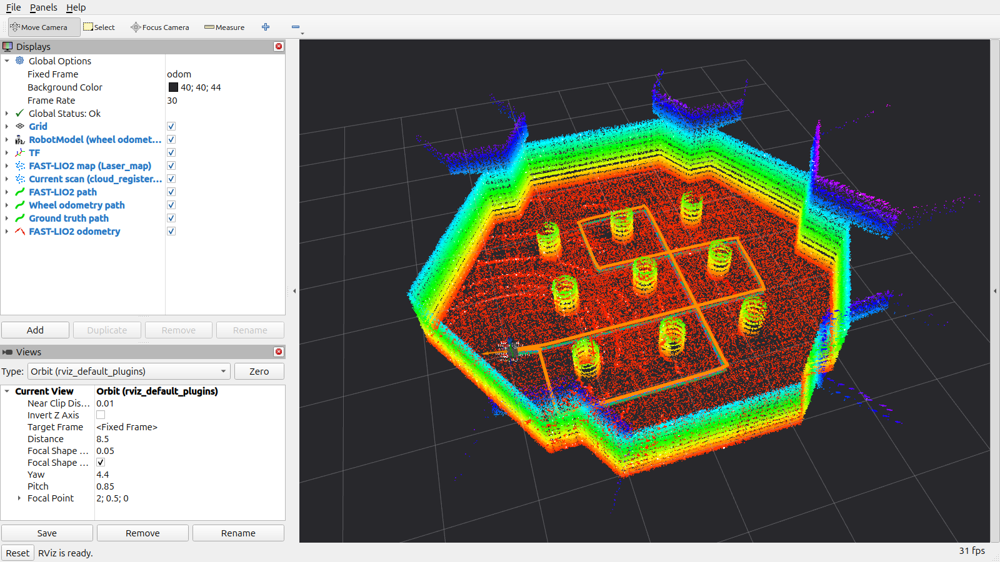
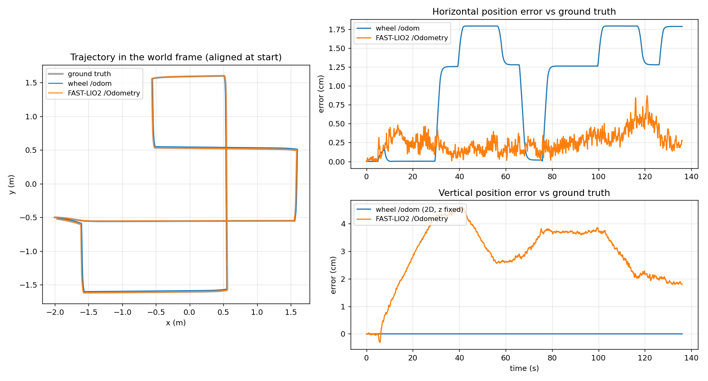

# 3주차 — FAST-LIO2 위치·지도 추정 (wanjun)

TurtleBot3 Burger의 16채널 3D LiDAR와 IMU를 FAST-LIO2에 연결해 3D 점군 지도와 궤적을 표시하고, 바퀴 odometry 및 시뮬레이터 정답 위치와 비교합니다.

## 사용한 구성

| 파일 | 역할·변경 |
| --- | --- |
| `launch/fast_lio_rviz.launch.py` | 제공 기본 설정과 개인 override 병합, 정적 TF, FAST-LIO2, RViz 실행 |
| `config/fast_lio_overrides.yaml` | 지도 저장 활성화; 기본 추정 파라미터 유지 |
| `rviz/fast_lio.rviz` | 지도·현재 스캔·FAST-LIO2/바퀴/정답 궤적, 1600×900 촬영 시점 |
| `tools/drive_route.py` | 제공 고정 경로를 0.15 m/s·0.6 rad/s로 주행, odometry 1초 끊김·300초 시간제한 시 정지 |
| `tools/odom_compare.py` | IMU 기준점을 바닥 기준점으로 변환, 시작 자세 정렬, 시간 보간 후 오차 계산; 누락·시간 역전 검증과 원시 샘플 저장 추가 |
| `tools/replay_experiment.py` | 별도 ROS 도메인에서 새 추정기·비교기 실행 후 동일 bag 재생, 실행한 프로세스 종료 |
| `tools/analyze_samples.py` | 저장한 원시 샘플에서 지정한 시뮬레이션 시각 구간을 같은 조건으로 재분석 |
| `scripts/setup_local.sh` | sudo 없이 로봇 description과 FAST-LIO2를 사용자 작업공간에 빌드 |
| `scripts/record_bag.sh` | 비교 실험용 센서·정답·시뮬레이션 시각 기록 |
| `tests/test_odom_compare.py` | IMU 장착 오프셋 보정, 잘못된 오프셋, 누락, 시각 역전, 시간 불일치 검증 |

## 환경 준비

검증 PC: Ubuntu 24.04.5 LTS, ROS 2 Jazzy, Gazebo Sim 8.15.0, RTX 5070 Ti (16 GB), RViz 14.1.23. FAST-LIO2는 `a4743b0` + 제공 Jazzy C++17 패치, TurtleBot3 description은 `2.3.6`입니다.

모든 명령은 저장소 루트에서 `cd week3-slam/wanjun` 후 실행합니다. Python venv/conda는 사용하지 않습니다.

```bash
# 시스템 의존성이 없는 PC: sudo 설치가 필요합니다.
bash ../preparation/scripts/install_dependencies.sh

# 이 PC에서는 시스템 라이브러리가 이미 있었고 로봇 모델만 없어 아래 방식 사용.
bash scripts/setup_local.sh
bash scripts/check_environment.sh
```

`setup_local.sh`는 PCL, Eigen, ROS, NumPy, Matplotlib 등이 이미 설치된 환경을 전제로 합니다. `~/aistudy_fastlio_ws`에 공식 소스를 받고 필요한 패키지를 빌드합니다. 다른 경로를 쓰려면 **모든 터미널에 동일한 `FASTLIO_WS`**를 지정합니다. 소스 보관용 `vendor/`는 `COLCON_IGNORE`로 제외해 실물 로봇용 패키지를 불필요하게 빌드하지 않습니다.

## 실행

새 터미널마다 같은 폴더로 이동합니다. 기본 통신 설정은 `ROS_DOMAIN_ID=43`, `GZ_PARTITION=aistudy-week3-43`입니다. 2주차 환경변수가 남아 있다면 지우거나 이 값들로 맞춥니다.

```bash
# 터미널 1: Gazebo 센서·물리, GUI 없이 실행
bash scripts/run_simulation.sh

# 터미널 2: FAST-LIO2 + RViz
# 로봇을 정지시키고 "IMU Initial Done"과 "Initialize the map kdtree" 확인
bash scripts/run_fast_lio_rviz.sh

# 터미널 3: 비교 기록 (Ctrl+C 시 CSV·원시 샘플·JSON·그래프 저장)
bash scripts/run_compare.sh

# 터미널 4: 기둥 사이 고정 경로 한 바퀴
bash scripts/run_route.sh
# 직접 조종하려면 위 주행 도구 대신:
# bash ../preparation/scripts/run_teleop.sh
```

고정 경로 도구는 바퀴 `/odom`으로 waypoint를 따라갑니다. Nav2 및 장애물 회피 기능은 사용하지 않으므로 제공 sandbox 월드·기본 시작 위치 `(-2.0, -0.5, yaw=0)`에서 사용합니다. 한 번 실행 후 다시 같은 경로를 측정하려면 시뮬레이션과 FAST-LIO2를 모두 재시작합니다.

주행 종료 로그 `route finished`를 확인하고, 비교 터미널에서 Ctrl+C로 수치를 저장합니다. 그 다음 필요하면 지도를 저장합니다. 지도 저장 중 발생하는 처리 지연이 주행 오차에 섞이지 않도록 기록을 먼저 종료합니다.

```bash
source ../preparation/scripts/env.sh
ros2 service call /map_save std_srvs/srv/Trigger
# results/fastlio_map.pcd
```

종료는 각 실행 터미널에서 Ctrl+C를 누릅니다. `results/`의 bag·빌드 로그·원시 데이터는 git에서 제외하며, 제출 결과만 `media/`에 둡니다.

## 입력·출력과 좌표계

| 토픽 | 의미 | 기준 프레임 / 목표 주기 |
| --- | --- | --- |
| `/points` → `/points_fastlio` | 3D 점군에서 무한대·근거리 점 제거 | `lidar_3d_link`, 10 Hz |
| `/imu` | 각속도·선형가속도 | `imu_link`, 200 Hz |
| `/Odometry` | FAST-LIO2가 추정한 IMU 위치·자세 | `camera_init` → `body`, 10 Hz |
| `/path` | FAST-LIO2 궤적 | `camera_init` |
| `/cloud_registered` | 추정 위치로 변환한 현재 스캔 | `camera_init` |
| `/Laser_map` | 누적 3D 점군 지도 | `camera_init`, 약 1 Hz |
| `/odom` | 바퀴 odometry, 비교·주행 제어용 | `odom` → `base_footprint`, 약 29.4 Hz |
| `/ground_truth/odom` | 시뮬레이터 실제 위치, 평가 전용 | `world` → `base_footprint`, 50 Hz |

```text
odom → base_footprint → base_link → imu_link / lidar_3d_link
  └─ 정적 TF (-0.032, 0, 0.078) → camera_init → body
```

`body`는 IMU 기준점이고 RViz RobotModel은 바퀴 odometry 기준입니다. 정적 TF는 로봇이 `odom` 원점에 정지한 채 추정기를 시작했다는 조건의 표시용 연결입니다. 이동 후 추정기만 재시작하면 맞지 않습니다. `body`를 `base_link`의 부모로 추가하지 않습니다.

모든 실행 노드는 `/clock`의 시뮬레이션 시간을 사용합니다. Gazebo 점군에는 점별 측정 시각이 없으므로 제공 `lidar_type: 5`를 유지합니다. LiDAR의 IMU 기준 장착 위치는 `extrinsic_T: [0.0, 0.0, 0.192]`입니다.

FAST-LIO2는 IMU로 스캔 사이 움직임을 예측하고, LiDAR 점들을 지도 평면에 맞춰 위치·자세를 보정합니다. 보정된 자세로 점들을 지도에 추가합니다. 바퀴 odometry와 정답 위치는 추정 입력으로 사용하지 않습니다.

## 바퀴 odometry와 비교하는 방법

| 항목 | 바퀴 `/odom` | FAST-LIO2 `/Odometry` |
| --- | --- | --- |
| 센서 | 바퀴 회전량 | LiDAR + IMU |
| 추정 상태 | 평면 x·y·yaw | 3D 위치·자세 |
| 기준점 | `base_footprint` | IMU (`body`) |
| 지도 생성 | 없음 | 점군 지도 생성 |
| 오차 요인 | 미끄러짐·바퀴 치수·회전 중심 | 환경의 기하 구조·센서 시간·외부 파라미터·IMU 바이어스 |

수치 비교에서는 IMU 장착 위치 `(-0.032, 0, 0.078)`를 회전까지 반영해 `base_footprint`로 환산합니다. 각 추정기의 첫 샘플을 같은 시각의 정답 자세에 정렬하고, 정답 위치·자세를 추정 시각으로 보간합니다. 따라서 아래 오차는 **시작 정렬 이후의 상대 추정 오차**이며 절대 위치 정확도 주장이 아닙니다. 바퀴는 평면 정렬, FAST-LIO2는 3D 정렬을 사용합니다.

## 동일 데이터 설정 실험

본 주행 전에 별도 터미널에서 기록을 시작하고, 주행이 끝나면 Ctrl+C로 종료합니다. bag에 기존 FAST-LIO2 출력이나 TF를 넣지 않아 재생 추정과 섞이지 않게 합니다.

```bash
bash scripts/record_bag.sh "$PWD/results/my_bag"

# 각 실행은 새 출력 폴더를 사용합니다. 원래 시뮬레이터와 다른 ROS 도메인입니다.
ROS_DOMAIN_ID=44 bash scripts/run_replay.sh results/my_bag \
  config/experiments/baseline.yaml results/replay_baseline
ROS_DOMAIN_ID=45 bash scripts/run_replay.sh results/my_bag \
  config/experiments/voxel_0.2.yaml results/replay_voxel_0.2
```

변경 변수는 스캔·지도 voxel 크기 `0.1 → 0.2 m`입니다. 각 실험은 새 FAST-LIO2 프로세스와 같은 bag을 사용합니다. 재생은 기록된 `/clock`을 사용하므로 `ros2 bag play --clock`을 추가하지 않습니다. 두 설정 모두 지도 저장을 끄고 비교합니다.

실제 검증에는 `results/baseline_bag`의 처음 **180초**만 재생했습니다(`run_replay.sh ... --duration 180`). 정지 초기화부터 전체 주행과 종료 정지를 포함하며, 재생 결과도 아래와 같이 **227.94–364.02초**만 분석했습니다.

```bash
python3 tools/analyze_samples.py results/replay_baseline/samples.json \
  results/replay_baseline_window --start 227.94 --end 364.02
python3 tools/analyze_samples.py results/replay_voxel_0.2/samples.json \
  results/replay_voxel_window --start 227.94 --end 364.02
```

| 같은 bag 재생 설정 | 수평 RMSE | 수평 최대 | 방향 최대 | 수직 최대 |
| --- | --- | --- | --- | --- |
| voxel 0.1 m | **0.285 cm** | 0.770 cm | 0.204° | 4.582 cm |
| voxel 0.2 m | 1.039 cm | 2.064 cm | 0.451° | 2.076 cm |

[실험 수치 JSON](media/experiments.json), [0.1 m 그래프](media/baseline_0.1_trajectories.png), [0.2 m 그래프](media/voxel_0.2_trajectories.png), 계산 데이터([0.1 m CSV](media/baseline_0.1_vs_truth.csv), [0.2 m CSV](media/voxel_0.2_vs_truth.csv))를 함께 남겼습니다.

이 주행에서는 voxel을 크게 하면 수평 RMSE가 약 **3.6배** 커지고 방향 오차도 커졌습니다. 기둥과 벽의 정합에 쓸 점이 줄어드는 영향으로 해석해 기본 0.1 m를 유지했습니다. 수직 오차는 오히려 작아졌으므로 모든 축의 성능이 일괄적으로 나빠졌다고 볼 수는 없습니다. 설정당 한 번의 재생 결과입니다. 실시간 기본 실행(0.291 cm)과 기본 재생(0.285 cm)은 초기화 시점과 처리 순서가 달라 완전히 같지는 않습니다.

## 검증·문제 해결

```bash
source ../preparation/scripts/env.sh
python3 -m unittest discover -s tests -v
ros2 topic list --no-daemon --spin-time 3
ros2 topic echo /Laser_map --once --field width
```

- 최초 환경 점검에서 로봇 모델 패키지가 없었습니다. 시스템 라이브러리는 이미 설치되어 있어 사용자 작업공간 빌드로 해결했습니다.
- 최초 로컬 빌드 때 vendor의 TurtleBot3 전체 패키지가 검색되었습니다. vendor를 colcon 검색에서 제외하고 description만 src에 연결했습니다.
- DDS 토픽 검색 직후 일부 토픽이 누락되어 보였지만, 검색 대기 후 `/Laser_map`의 실제 수신과 RViz 표시를 확인했습니다.
- RViz의 접근성 창 조회가 실패해 X11 창 캡처로 스크린샷·영상을 기록했습니다.
- 이 PC의 보조 모니터에 맞춘 창 위치가 저장되어 있습니다. 다른 화면에서는 창 위치·크기를 조절하고 RViz 설정을 저장하면 됩니다.

## 결과 및 학습 기록

2026-10-04 이 PC에서 기본 설정으로 기둥 사이 **15.56 m**를 완주했습니다. 분석 구간은 시뮬레이션 시각 **227.94–364.02초(136.08초)**로, 실제 이동 전후 약 5초를 포함합니다. 주행 종료 후 문서 작업 중 길어진 정지 구간을 제외했고, 모든 비교에 같은 구간을 사용합니다.

- [RViz 주행 영상](media/fastlio_rviz.mp4): 1280×720, 10 fps, **138초·1배속**. 시작 정지 → 주행 → 종료 정지를 담았습니다. 원본 영상의 긴 종료 후 대기 구간만 잘랐습니다.
- [RViz 지도·궤적 스크린샷](media/rviz_fastlio_map.png)
- [궤적·오차 그래프](media/trajectories.png), [수치 JSON](media/metrics.json)
- 검토용 계산 데이터: [바퀴 CSV](media/wheel_vs_truth.csv), [FAST-LIO2 CSV](media/fastlio_vs_truth.csv)
- `/map_save`가 `success=True, Map saved.`를 반환했고, 로컬 `results/fastlio_map.pcd`를 생성했습니다. PCD와 1 GB 원본 bag은 제출에서 제외했습니다.



| 정답 위치 대비 | 바퀴 odometry | FAST-LIO2 |
| --- | --- | --- |
| 수평 RMSE | 1.278 cm | **0.291 cm** |
| 수평 최대 오차 | 1.793 cm | 0.871 cm |
| 종료 시 수평 오차 | 1.787 cm | 0.276 cm |
| 방향 최대 오차 | 0.006° | 0.189° |
| 수직 최대 오차 | 평면 모델로 z 고정 | 4.595 cm |
| 측정 발행 주기 | 29.41 Hz | 10.00 Hz |



바퀴 오차는 방향 전환에 따라 계단 모양으로 변했고 직진 구간에서는 거의 일정했습니다. FAST-LIO2의 수평 오차는 이 주행에서 더 작았지만, 높이는 최대 약 4.6 cm까지 변했습니다. 평지·16채널 점군의 관측 제약과 IMU 기반 자세 추정이 영향을 줄 수 있으나 이번 실험만으로 원인을 분리하지는 못했습니다. 바퀴 모델의 z 고정은 실제 3D 높이 추정 능력을 의미하지 않습니다.

기준점을 보정하지 않으면 IMU가 바닥 기준점 뒤로 3.2 cm 떨어진 효과가 회전 오차에 섞입니다. 테스트에서는 정확한 가상 궤적도 잘못된 오프셋으로 비교하면 180° 회전 시 **6.4 cm** 오차가 생기는 것을 확인했습니다.

동일 구간의 재분석 명령:

```bash
source ../preparation/scripts/env.sh
python3 tools/analyze_samples.py results/baseline/samples.json results/baseline_window \
  --start 227.94 --end 364.02
```

환경 점검 전체 항목, 고정 경로 10개 waypoint 완주, 지도 저장, 좌표계·입력 검증 테스트 **5개**를 확인했습니다.

개인 Notion 링크는 아직 제공되지 않았습니다. 학습 기록에는 설치·빌드 문제, 기준점 보정 이유, 실제 측정 결과, voxel 변경 관찰을 정리할 예정입니다. Nav2 연결은 선택 확장으로 남깁니다.
